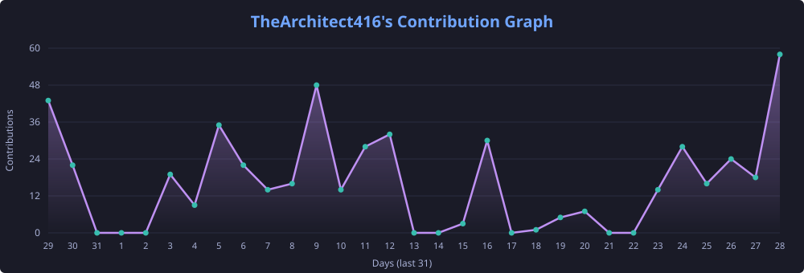

  

  
  
  

---

## 🚀 About Me

> *"Architecting solutions, one line of code at a time."*

- 🏢 **Currently:** **AI & Automation Engineer** at **ITC Infotech**, Bangalore — building **agentic AI** for workforce management on **Azure AI**.
- 🎓 **Education:** **BE in AI & ML**, Jyothy Institute of Technology (2026) — CGPA 8.25.
- 📈 **Building on the side:** **FinMark** — an automated trading system, soon to be AI-powered.
- 🛠️ **Focus areas:** **Agentic AI & Multi-Agent Systems (LangChain · LangGraph)**, **Generative AI**, **Cloud (AWS · Azure · GCP)**, **Full-Stack (FastAPI · Next.js)** and **Android (Kotlin · Jetpack Compose)**.
- ☁️ **Community:** Former **AWS & Google Cloud Student Ambassador** — ran workshops, hands-on labs and mentorship.
- 🧠 **Problem Solver:** Keeping sharp with **Data Structures & Algorithms** in Java.
- 📫 **Contact:** **akashathreyas@gmail.com**
- ⚡ **Creative Side:** My poetry lives at [@poems.with.akash](https://www.instagram.com/poems.with.akash)

---

## 🛠️ Languages and Tools

| **Domain** | **Technologies** |
|:---:|:---|
| **Languages** |      |
| **AI / ML** |              |
| **Frontend** |     |
| **Backend** |      |
| **Database** |      |
| **Cloud & DevOps** |        |
| **IDEs & Tools** |       |

---

## 🎯 Featured Projects

| Project | Description | Tech Stack |
| :--- | :--- | :--- |
| **FinMark** 📈 | **Automated Trading System — soon to be AI-powered.** Automated trading across Indian and crypto markets — US markets and Forex coming soon. |    |
| **VidyaSarathi** 🎓 | **AI-powered academic management system.** One platform for an AI course planner, timetable generator, lesson-plan builder, geo-location attendance and a discovery engine. Integrates Gemini & GPT-4o mini, with CSV/PDF exports and CoE parsing. |       |
| **Blood Cancer Type Detection** 🩸 | **🥉 3rd Place — CSI Student Chapter Project Exhibition (Nov '24).** Fine-tuned GoogLeNet to classify ALL subtypes, reaching up to **99.66% accuracy** through a redesigned classifier head. |    |

### 📱 Android

| Project | Description | Tech Stack |
| :--- | :--- | :--- |
| **TriNetizen** | **Real-time global intelligence platform.** Aggregates geopolitical events, disasters, conflict data, markets and news from 20+ sources onto a 3D globe with 37 data layers. |    |
| **[EV-Grama Charge](https://github.com/TheArchitect416/ev-gramacharge)** 🔗 | **Community-driven EV charging for rural India.** "Airbnb for EV charging" — riders find and book sockets hosted by local households and shops, with OTP auth, live map and a range calculator. |   |

---

## 🏆 Achievements

- 🥈 **2nd Place — Satwa 2k25**, 36-hour national hackathon @ Saintgits College, Kerala (Feb '25) — built a smart-shopping Chrome extension with ML models, web scraping and LLMs.
- 🏅 **Top 50 — MindScape @ BNMIT** by IBM SkillsBuild (Jul '25) — built **StressNet**, an AI mental-wellness platform that detects stress from speech, video and social media with explainable recommendations.
- 🥉 **3rd Place — CSI Student Chapter Project Exhibition** (Nov '24) — blood cancer type detection with GoogLeNet.
- ☁️ **AWS & Google Cloud Student Ambassador** (May '24).

---

## 📊 GitHub Statistics

  
  

  

---

## 📊 Contribution Graph

  

---

### 🐍 Contribution History

  

⚡ <strong>Expand for Detailed Metrics</strong>

 

  
   
  

---

## 📚 My Favorite Books

|                                                                                                                                                                                                       | **Book**                                                                                                                                                                                                                          | **Rating** |
| :---------------------------------------------------------------------------------------------------------------------------------------------------------------------------------------------------: | :-------------------------------------------------------------------------------------------------------------------------------------------------------------------------------------------------------------------------------- | :--------: |
|                                | **[A Confession](https://www.goodreads.com/review/show/7898413617)** _by [Leo Tolstoy](https://www.goodreads.com/author/show/128382.Leo_Tolstoy)_ tagged: favorite                                               | ⭐⭐⭐⭐⭐ |
|                       | **[A Stranger to Myself](https://www.goodreads.com/review/show/7898400811)** _by [Willy Peter Reese](https://www.goodreads.com/author/show/66694.Willy_Peter_Reese)_ tagged: favorite                            | ⭐⭐⭐⭐⭐ |
|                | **[The Sorrows of Young Werther](https://www.goodreads.com/review/show/7898397117)** _by [Johann Wolfgang von Goethe](https://www.goodreads.com/author/show/285217.Johann_Wolfgang_von_Goethe)_ tagged: favorite | ⭐⭐⭐⭐⭐ |

 

---

## 📫 Connect with Me

  
  
  
  
  

---

  

  
💫 <i>Show some ❤️ by starring my repositories!</i>

